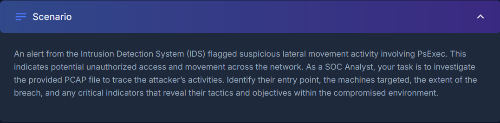
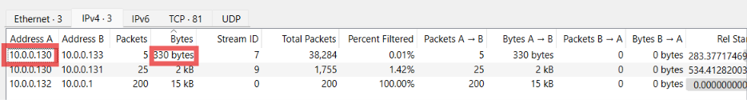
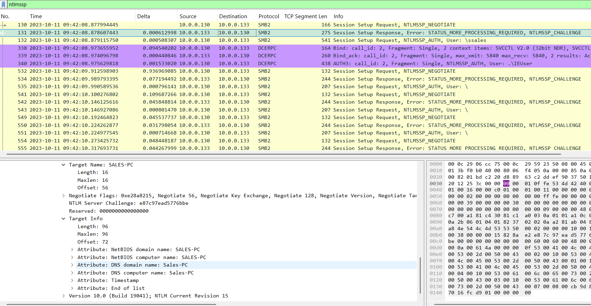
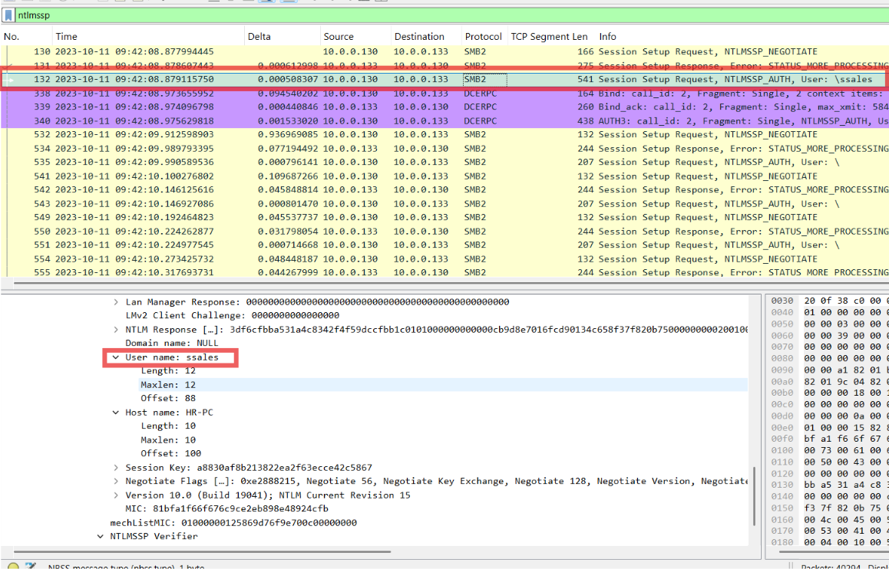
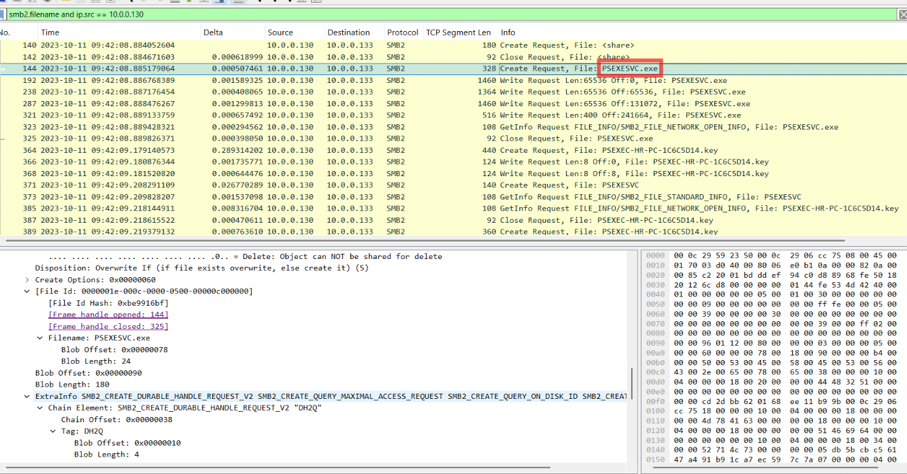
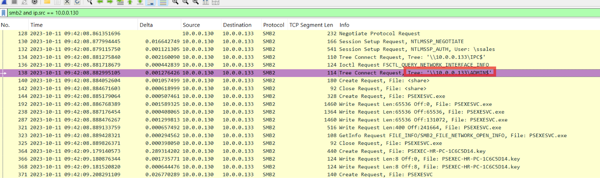
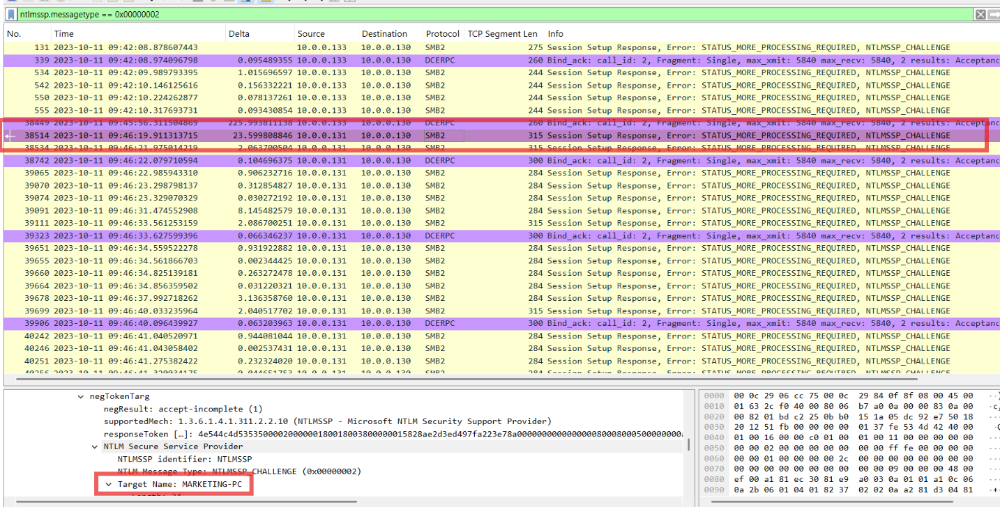

# PsExec Hunt Lab

## Context:

Before I dive in, I needed to do some research about SMB:

SMB or Server Message Block is a network communication protocol used to share files, printers, serial ports and other resources between nodes on a network. It's a fundamental application layer network protocol. SMB is a high value attack surface and a primary vehicle for lateral movement. It operates over TCP port 445 and legacy TCP/UDP port 139.

### Q1. To effectively trace the attacker's activities within our network, can you identify the IP address of the machine from which the attacker initially gained access?

I start by finding out who is initiating connections. In a TCP handshake, the client sends the first packet with only the SYN flag set, so this filter shows just those opening packets:

`tcp.flags.syn == 1 && tcp.flags.ack == 0`

The source IP of these packets is the side starting each connection. One IP sending SYNs to many ports or hosts is a strong sign of scanning.

To confirm, I open **Statistics → Conversations** and sort by bytes. The IP with the most traffic, 10.0.0.130, is the same one sending the scan SYNs, which makes it the attacker.

### Answer: 10.0.0.130

### Q2. To fully understand the extent of the breach, can you determine the machine's hostname to which the attacker first pivoted?

This one took me a while to find and understand, but with some research I found the filter `ntlmssp`. NTLMSSP is the protocol Windows uses when one machine logs in to another over the network, for example over SMB. Every login happens in three steps:

1. **NEGOTIATE** – the client says it wants to log in.
2. **CHALLENGE** – the server answers, and in that answer it introduces itself with its own computer name.
3. **AUTH** – the client sends its username and proof of the password.

The idea is to find the first packet where the Info column says **NTLMSSP_CHALLENGE**, because that means the target machine is replying to the attacker and telling us its name. Here that is packet 131, sent from 10.0.0.133 back to the attacker at 10.0.0.130.
 

### Answer: SALES-PC

### Q3. Knowing the username of the account the attacker used for authentication will give us insights into the extent of the breach. What is the username utilized by the attacker for authentication?

I used the same `ntlmssp` filter as in the previous question. Remember the three login steps: after the target sends the **CHALLENGE**, the attacker answers with **NTLMSSP_AUTH**, and that message contains the username they are logging in with.

The first AUTH is packet 132, sent from the attacker (10.0.0.130) to SALES-PC (10.0.0.133). The Info column already shows `User: \ssales`, and expanding **NTLMSSP → NTLMSSP_AUTH** confirms the **User name** field is `ssales`.

### Answer: ssales

### Q4. After figuring out how the attacker moved within our network, we need to know what they did on the target machine. What's the name of the service executable the attacker set up on the target?

To see which files the attacker touched on the target, I filtered for SMB file names sent from the attacker's IP:

`smb2.filename and ip.src == 10.0.0.130`

PsExec works by copying a small program onto the target and then asking Windows to run it as a service. In the results, packet 144 shows the attacker creating `PSEXESVC.exe` on SALES-PC, followed by several **Write Requests** (packets 192–321) that upload the file in chunks, and a **Close Request** (packet 325) when the upload is done. Right after this, the attacker connects to **SVCCTL**, the Windows service manager, to start it as a service.

### Answer: PSEXESVC.exe

### Q5. We need to know how the attacker installed the service on the compromised machine to understand the attacker's lateral movement tactics. This can help identify other affected systems. Which network share was used by PsExec to install the service on the target machine?

I filtered for all SMB traffic sent by the attacker:

`smb2 and ip.src == 10.0.0.130`

In SMB, a **Tree Connect Request** is how a client opens a network share. After logging in, the attacker connects to two shares:

- `IPC$` (packet 134) – a special share used for communication between programs, which PsExec later uses to talk to the service manager.
- `ADMIN$` (packet 138) – a hidden admin share that points to `C:\Windows` on the target.

Right after connecting to `ADMIN$`, the attacker creates and uploads `PSEXESVC.exe` (packets 144–325). Checking the **Tree Id** in the SMB2 header of packet 144 confirms the file was written to `\\10.0.0.133\ADMIN$`, so the service executable was placed in `C:\Windows` on SALES-PC.

### Answer: ADMIN$

### Q6. We must identify the network share used to communicate between the two machines. Which network share did PsExec use for communication?

This was answered with the same reasoning as the previous question.

### Answer: IPC$

### Q7. Now that we have a clearer picture of the attacker's activities on the compromised machine, it's important to identify any further lateral movement. What is the hostname of the second machine the attacker targeted to pivot within our network?

I used the same method as in Q2 and Q3. To narrow it down to only the CHALLENGE messages (where the target introduces itself), I right-clicked the NTLMSSP Message Type field and chose **Apply as Filter**, which gave:

`ntlmssp.messagetype == 0x00000002`

Looking at the **Source** column, all the early CHALLENGE packets come from 10.0.0.133 (SALES-PC, the first target). Packet 38514, about four minutes later, is the first CHALLENGE from a new IP, **10.0.0.131**, which means the attacker started logging in to a second machine. Expanding the NTLMSSP details shows its computer name: `MARKETING-PC`.

### Answer: MARKETING-PC

[Link to the lab](https://cyberdefenders.org/blueteam-ctf-challenges/psexec-hunt/)